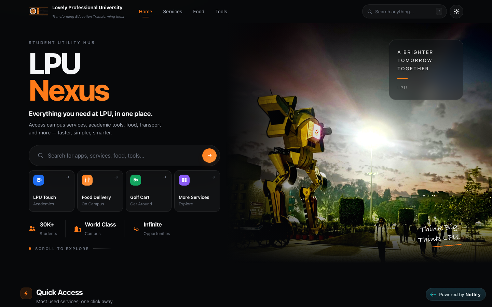

# LPU Nexus

At LPU there's a separate app or portal for almost everything: UMS for academics, LPU Live for chat, one app for golf carts, another for cycles, another for food queues. As a new student I kept asking around for the right links, so I put them all on one page.

Live site: https://lpunexus.netlify.app/



## What's on it

- A quick access bar with links to LPU Touch, LPU Live, LPU.in, food delivery, Golf Cart, My Horse and Smart Q
- Cards for each campus service (those plus UMS and the LPU Dashboard), with a few "how to use" steps and a link to the app or portal
- Search that filters services, tools and food courts as you type. Press `/` to jump to it and `Esc` to clear it
- An SGPA/CGPA calculator on LPU's 10-point scale. Add as many courses as you want, and if you enter your previous CGPA and credits it works out the updated CGPA too
- A grade converter between letter grades (O, A+, A ... F) and grade points, with a rough percentage (grade point x 10)
- A food courts page for Central Mess, Food Factory, Kitchen Ette and NK Food Court, each with a Google Maps directions link
- Dark and light themes (it remembers which one you picked)
- Works on phones, and the scroll animations turn off if your system has reduced motion on

The calculator is just for a quick estimate. Your official grades are always the ones on UMS.

It's a plain static site: no sign-up, no backend, and nothing you type gets sent anywhere.

## Running it locally

There's nothing to install or build.

```bash
git clone https://github.com/ganesh-tadigadapa/lpu-nexus.git
cd lpu-nexus
python3 -m http.server 8000   # then open http://localhost:8000
```

Or just open `index.html` in a browser.

## Files

```
index.html       home page: quick access, services, student tools, food
foodcourts.html  food courts page
index.css        styles for both pages
index.js         theme toggle, search, nav, calculator, grade converter
```

The images for the service and food court cards are in the root folder.

## Built with

HTML, CSS and plain JavaScript (no frameworks). Hosted on Netlify.
