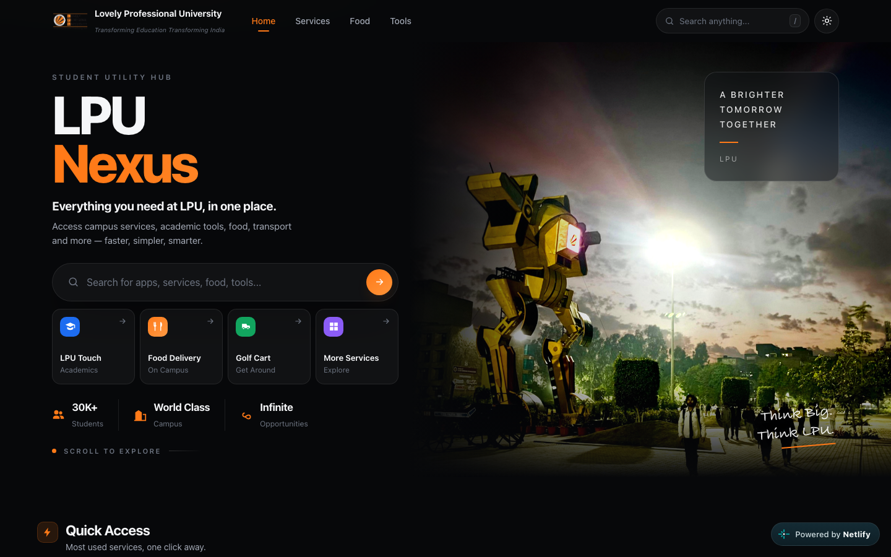

<div align="center">


# LPU Nexus

**Everything you need at LPU, in one place.**

[](https://lpunexus.netlify.app/)


</div>

<p align="center">
  
</p>

---

## 📖 What is it

LPU Nexus is a student hub for Lovely Professional University (LPU). Instead of hunting for links across many apps and portals, you open one page and find the campus services, food courts and study tools you use every day.

It is a plain static website: no sign-up, no backend, and nothing you type is sent anywhere.

## ✨ Features

- 🔗 **Quick Access bar** – one-click links to LPU Touch, LPU Live, LPU.in, food delivery, Golf Cart, My Horse and Smart Q.
- 🏫 **Campus Services cards** – LPU Touch, LPU Live, LPU.in, Smart Q, LPU Golf Cart, My Horse, UMS, LPU Dashboard and Food Delivery, each with a short "How to use" guide and a link to the app or portal.
- 🔍 **Instant search** – filter services, tools and food courts as you type, from the hero box or the navbar. Press `/` to jump to search and `Esc` to clear it.
- 🧮 **CGPA / SGPA Calculator** – add as many courses as you like with credits and grades (LPU 10-point scale) to get your SGPA live, and optionally add your previous CGPA and credits to see your updated CGPA.
- 🔄 **Grade Converter** – switch between a letter grade (O, A+, A … F) and its grade point, with a 100-point equivalent (grade point × 10).
- 🍔 **Food courts page** – Central Mess, Food Factory, Kitchen Ette and NK Food Court, with location, a short description and a link to directions in Google Maps for each.
- 🌗 **Dark / light theme** – toggle in the navbar; your choice is remembered in the browser.
- 📱 **Responsive layout** – mobile menu, a navbar that condenses on scroll, and scroll-in animations that respect "reduced motion" settings.

## 🚀 How to use

1. Open **[lpunexus.netlify.app](https://lpunexus.netlify.app/)**.
2. Tap a **Quick Access** tile, or scroll to **Campus Services** and follow the "How to use" steps on any card.
3. Type in the search box (or press `/`) to find a service, tool or food court fast.
4. Go to **Student Tools** and click **Open calculator** to work out your SGPA/CGPA, or open the **Grade Converter**.
5. Check **Food at LPU** and click **View all** for the full food courts page.

> Always confirm your official grades and CGPA on UMS.

## 🛠️ Tech stack

| Layer | Used |
| --- | --- |
| Markup | HTML5 |
| Styling | CSS3 (custom properties, media queries, light/dark themes) |
| Scripting | Vanilla JavaScript (no frameworks, no build step) |
| Hosting | Netlify |

## 💻 Run locally

No install or build is needed.

```bash
git clone https://github.com/ganesh-tadigadapa/lpu-nexus.git
cd lpu-nexus
```

Then either open `index.html` directly in your browser, or serve the folder with any static server, for example:

```bash
python3 -m http.server 8000
# then visit http://localhost:8000
```

## 📁 Project structure

```text
lpu-nexus/
├── index.html        # Home: hero, quick access, campus services, student tools, food
├── foodcourts.html   # Food courts page
├── index.css         # All styles (shared by both pages)
├── index.js          # Theme, search, nav, CGPA calculator, grade converter
├── lpulogo.png       # Site logo / favicon
├── lpunexus.png      # Project logo
└── *.jpg / *.png / *.avif   # Service and food court images
```

---

<div align="center">

Made with ❤️ for LPU students.

</div>
